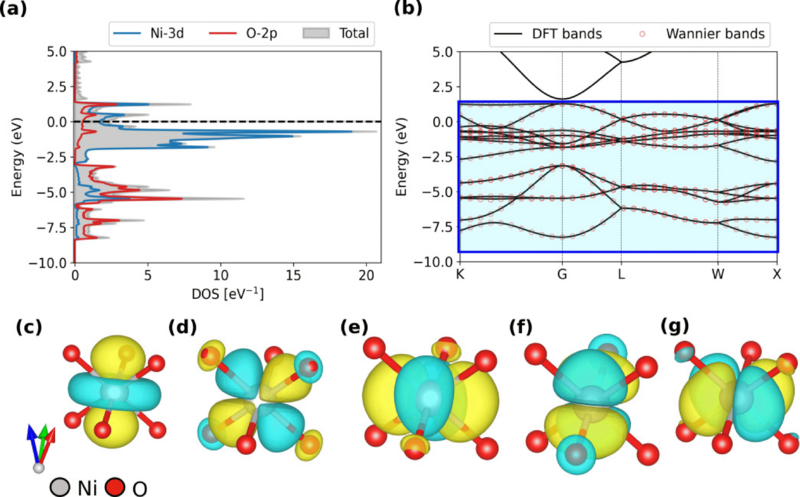

DFT+U 是在 Kohn–Sham 电子结构计算中，对选定局域轨道增加 Hubbard 型相互作用修正的方法。这里的 U 表示经过环境屏蔽的局域电子排斥能量尺度，通常以 eV 为单位。局域或半局域泛函对电子自相互作用的抵消不充分时，可能过度稳定电荷向多个原子分散的状态，甚至将磁性绝缘体算成金属。

+U 常用于改善含过渡金属 d 电子或稀土 f 电子材料的这类描述。以单轨道 Hubbard 模型为例，同一轨道的两个自旋分量各占据一个电子时，会产生 U n↑n↓ 形式的相互作用能。固体中的波函数沿晶体延展，局域轨道要通过投影函数从这些波函数中定义。原子型函数、正交化原子函数或 Wannier 函数都可用于构造受修正的子空间；将占据的 Kohn–Sham 态投影到该空间，得到局域占据矩阵。

  

NiO 的图1同时给出延展的能带和以 Ni 为中心的 d 型 Wannier 函数。图中的非磁性 DFT 状态用于建立轨道表示，实际低温 NiO 的反铁磁绝缘态需要相应磁序和电子相互作用描述。局域轨道的等值面具有方向与配体延展，投影占据测量的是电子在这些函数上的权重，未必与形式价态所用的整数电子计数一致。

将局域相互作用加到基础泛函后，还要处理重复计入的部分，总能常写为E_DFT_+U=E_DFT_+E_Hub_−EDC。EDC 是双计数扣除项，用于扣除基础泛函已经平均包含的局域相互作用；其形式采用近似约定。常用 Dudarev 简化形式将后两项合并为 Ecorr=½UeffΣImσλImσ(1−λImσ)。λ 是占据矩阵在某原子 I、轨道 m 和自旋 σ 下的本征值。

对正 Ueff，0<λ<1 的局域占据承担额外能量代价，λ=½ 时该项最大，λ=0 或 1 时为零。这种形式可减轻近似泛函对分数局域电荷的过度稳定。Dudarev 写法中常用 Ueff=U−J，J 表示同一原子壳层的 Hund 交换；显式保留 U、J 的其他形式还可能包含额外的轨道各向异性。

