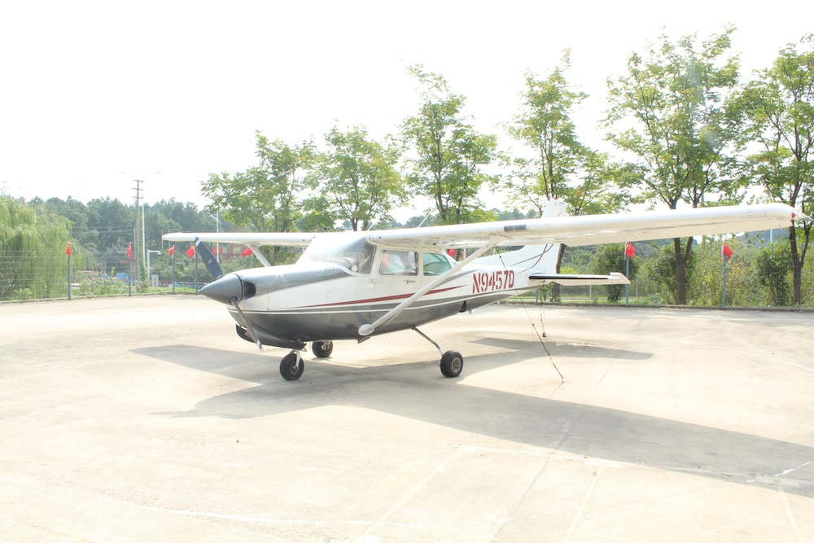
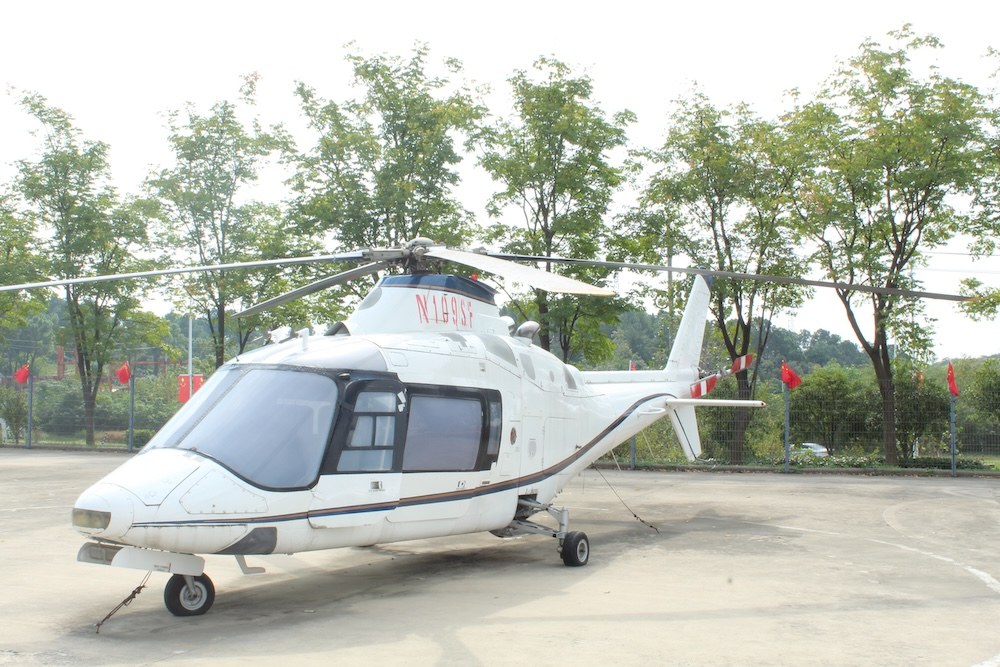
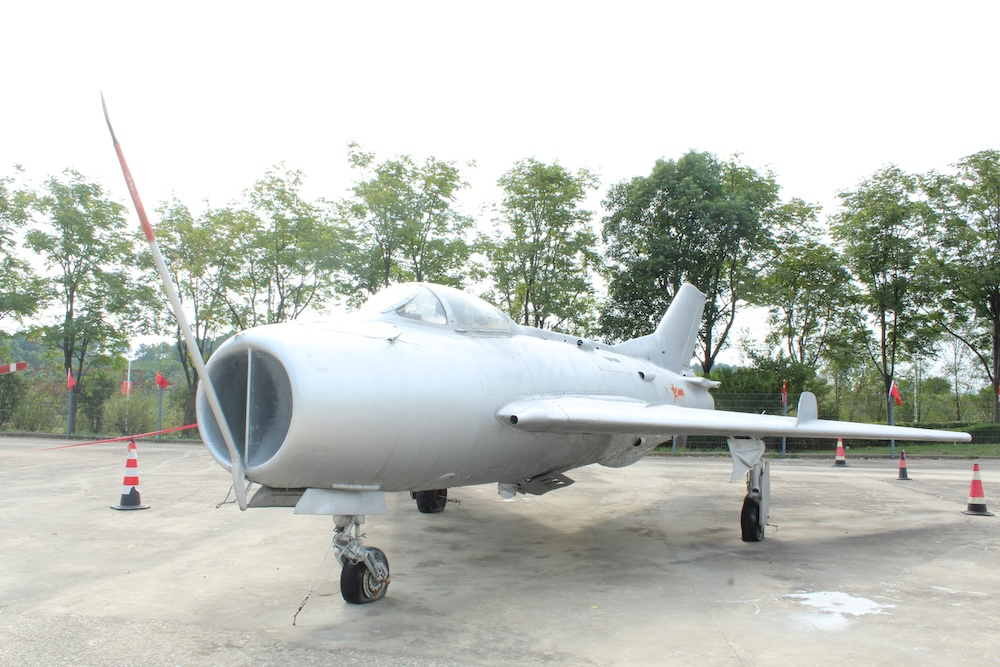

### 🛩️ 塞斯纳 172（注册号 N9457D）

照片中的这架是航空史上最经典的轻型飞机之一。塞斯纳172于1956年投产，累计产量超过4.5万架，是全球产量最大的轻型通用飞机。它采用单发活塞发动机和四座布局，皮实耐用、起降要求低，是飞行训练和私人飞行的“标杆机型”。根据注册号 N9457D 的记录，这架飞机的具体型号为 172RG Cutlass RG，主要特点是配备了可收放式起落架。

  

### 🚁 阿古斯塔韦斯特兰 A109（注册号 N109SF）

这是一架来自意大利的高性能双发轻型直升机。A109系列于1971年首飞，以飞行速度快、抗风能力强著称，是同级别中最成功的机型之一，广泛用于警用执法、医疗救护和行政运输。它采用四片桨叶全铰接旋翼和可收放轮式起落架，最高时速可达 305 公里左右。

  

### ✈️ 米格-15 比斯

这架银色战机是苏联米高扬设计局研制的第一代实用喷气式战斗机，也是米格-15的改进型号。“比斯”（Bis）换装了推力更大的克里莫夫 VK-1 发动机，最大时速约 1078 公里，实用升限超过 1.5 万米。它在抗美援朝战争中是中国人民志愿军空军的主力装备，与美制 F-86 战斗机同台较量，在航空史上具有标志性意义。

  

